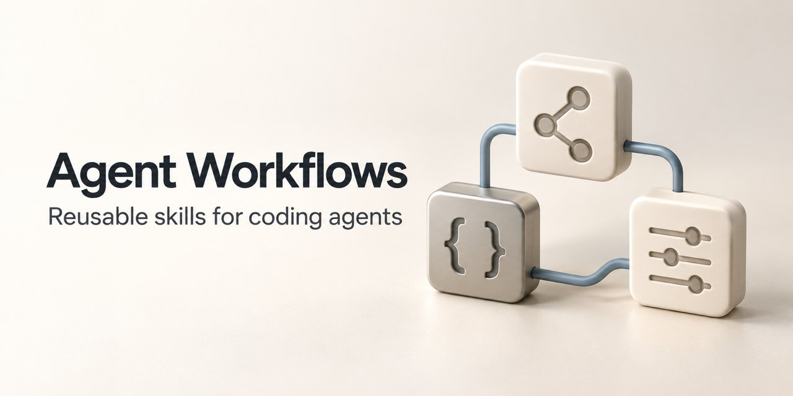

# agent-workflows

English | [简体中文](README.zh-CN.md)

[](https://github.com/nervouna/agent-workflows/releases/latest)

[](LICENSE)



Reusable workflow skills for AI coding agents, installed with the [Vercel Skills CLI](https://github.com/vercel-labs/skills), and a read-only command that audits a local Codex home (`~/.codex`). The skills are instructions written for Codex; they do not install tools or grant an agent new capabilities.

## Status

This is a personal project: the workflows its author uses with Codex, published so others can install the ones that fit. Several skills assume the author's environment (macOS, mise, uv, Xcode), and each one lists its prerequisites in the [skill catalog](skills/README.md). Installing skills needs Node.js, npm (with `npx`), Git and an agent that supports skills; the audit tool needs Python 3.12 or later and `uv`. No API key or account is needed to install anything here. The documentation is in Chinese and English; the skills themselves are in English.

Releases are source only. Skills install straight from the repository's `main` branch, and the audit tool runs from a checkout.

## How it is built

The repository's `AGENTS.md` holds the rules coding agents follow here: treat `~/.codex` as an external target that is inspected read-only by default, never print secrets, session content or auth files, require an explicit flag and a confirmation path for anything destructive, use `uv`, keep code in `src/codex_maintenance/` and tests in `tests/`, and run formatting, linting and tests before calling work done. See [CONTRIBUTING.md](CONTRIBUTING.md) to report a bug or send a fix, and [SECURITY.md](SECURITY.md) for security problems.

## Skills

| Skill | What it does |
| --- | --- |
| [app-icon-design](skills/app-icon-design/SKILL.md) | Designs and prepares app icons, with macOS and iOS icons finished in Apple's Icon Composer |
| [apple-signing-workflow](skills/apple-signing-workflow/SKILL.md) | Builds, packages and diagnoses signing for Apple platform apps: automatic signing, team, certificates, provisioning profiles, entitlements |
| [keep-calm-and-yolo-on](skills/keep-calm-and-yolo-on/SKILL.md) | Runs reviewed development of a complex feature: scoped requirements, planning, serial implementation, P0/P1 review, local task commits and final acceptance |
| [mcp-secrets-and-local-config](skills/mcp-secrets-and-local-config/SKILL.md) | Sets up MCP servers, API keys, `.env` files and 1Password `op` flows without exposing credentials |
| [node-npm-workflow](skills/node-npm-workflow/SKILL.md) | Handles Node, npm, npx, package manager choice, Corepack and mise-managed Node paths on macOS |
| [project-memory](skills/project-memory/SKILL.md) | Keeps durable project constraints and decisions in `.codex/project-memory.md`, so they travel with the repository |
| [python-workflow](skills/python-workflow/SKILL.md) | Handles Python interpreters, dependencies and tests with uv and mise on macOS |
| [review-and-merge-branch](skills/review-and-merge-branch/SKILL.md) | Reviews a committed local branch in independent rounds, fixes P0/P1 blockers, and merges it locally after a GO verdict; it does not push unless asked |

Read a skill's `SKILL.md` before installing it, to check that its permissions and environment fit yours. The [catalog](skills/README.md) lists each skill's prerequisites.

## Install skills

Install one skill for the current user's Codex:

```sh
npx skills add nervouna/agent-workflows --skill app-icon-design -a codex -g
```

Other forms:

```sh
# List the skills, or choose interactively for the current project
npx skills add nervouna/agent-workflows --list
npx skills add nervouna/agent-workflows -a codex

# Install every public skill into the current project
npx skills add nervouna/agent-workflows --skill '*' -a codex
```

Project installs go to `.agents/skills/`, global installs (`-g`) to `~/.agents/skills/`. Quote `'*'` so the shell does not expand it. Check for skills with the same name and for your own edits before installing, then confirm in a new agent task that the skill is available. With a local clone, you can pass the clone's absolute path instead of `nervouna/agent-workflows`. Run `npm view skills engines` for the CLI's Node.js requirement.

The repository also has an internal skill in `.agents/skills/` for its own maintenance. It is not part of the public catalog; `metadata.internal: true` only hides it from default discovery. To install the public skills in bulk, use `--skill '*'`, not `--all`.

## Codex home audit

`codex-maintenance audit` checks that a Codex home is kept as a Git repository with guards against committing secrets. It is read-only: it runs `git` commands and reads `.gitignore`, and does not read or print secrets, sessions or history. It does not replace `~/.codex` or store any Codex state.

```sh
uv run python -m codex_maintenance audit
uv run python -m codex_maintenance audit --codex-home <path> --json
```

The checks are: the directory exists, it is a Git repository, `core.hooksPath` is `hooks`, `hooks/pre-commit` and `.gitleaks.toml` exist, `.gitignore` starts with `*` followed by whitelist exceptions, and none of `auth.json`, `history.jsonl`, `sessions`, `shell_snapshots` or `secrets` is tracked. Output looks like this:

```text
Codex home: /Users/<you>/.codex
Status: pass
- pass: codex-home-exists (directory exists)
- pass: git-repository (git repository detected)
- pass: tracked-hooks-path (core.hooksPath=hooks)
...
```

The command exits with 1 if any check fails. See the [audit runbook](docs/runbooks/codex-home-audit.md). The Python package, module and command keep the names `codex-maintenance`, `codex_maintenance` and `codex-maintenance`.

## Development

```sh
uv run pytest
uv run ruff format --check .
uv run ruff check .
```

The tests check skill names, frontmatter, catalog links, self-contained skill directories and the bundled licenses, plus the audit command. `hooks/pre-commit` runs `gitleaks protect --staged --redact` and needs `gitleaks` installed. The [skill distribution runbook](docs/runbooks/skill-distribution.md) describes an isolated installation check.

## License

The repository is under the [MIT license](LICENSE), and each public skill carries the same license text.
